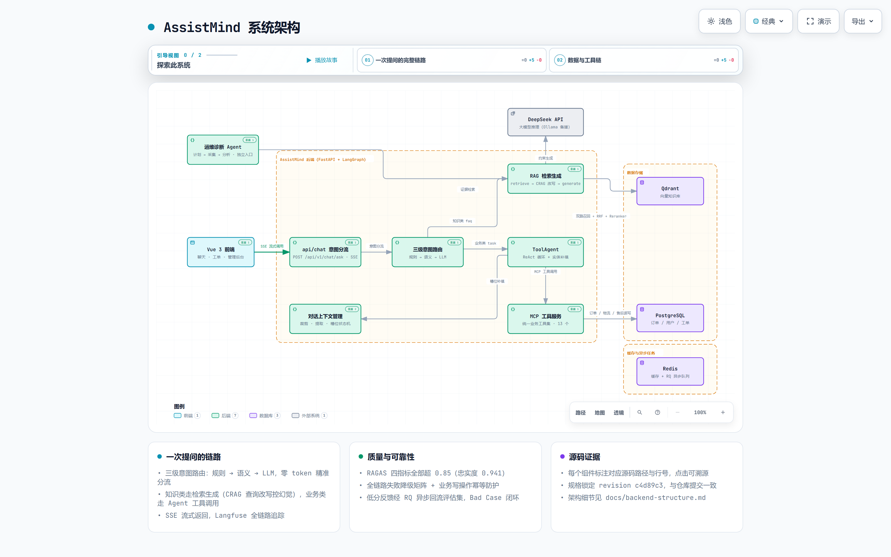
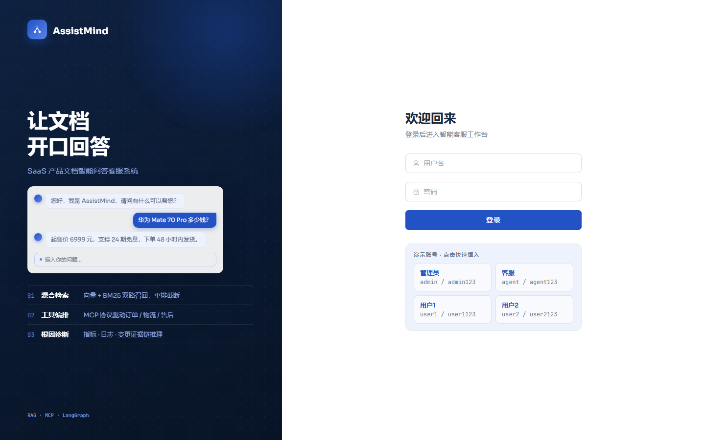
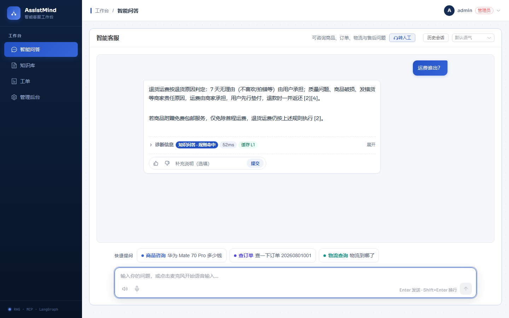
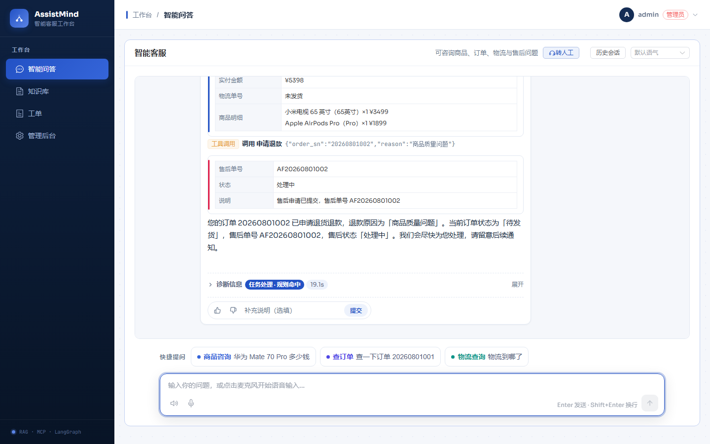
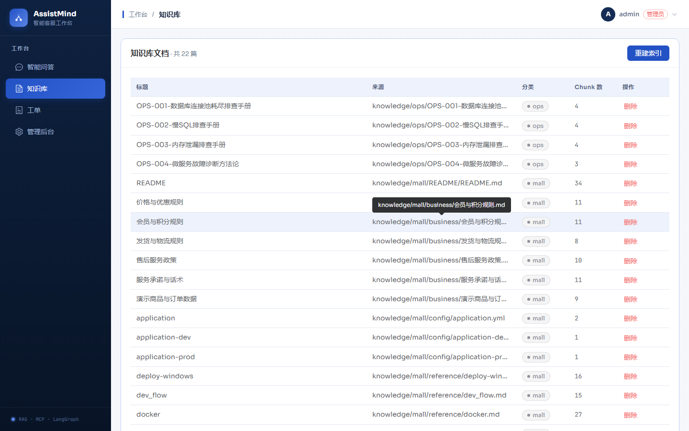
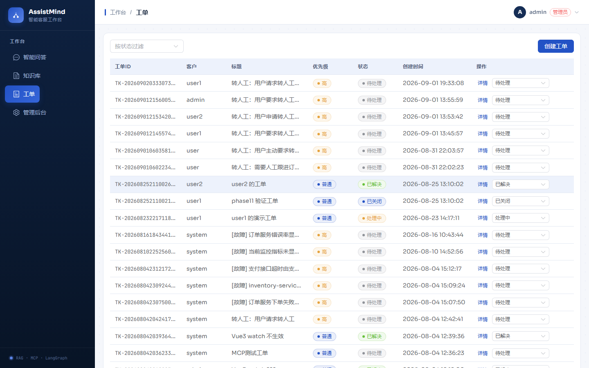
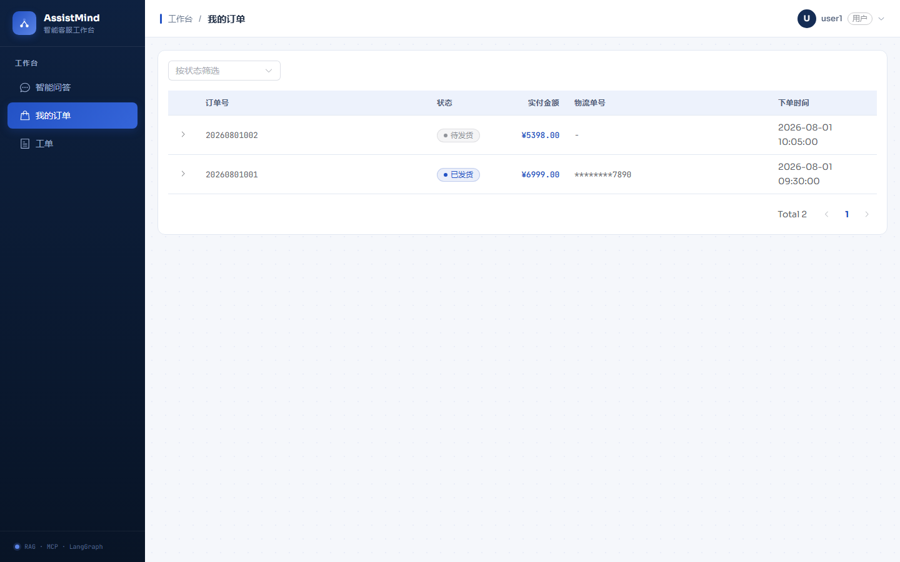
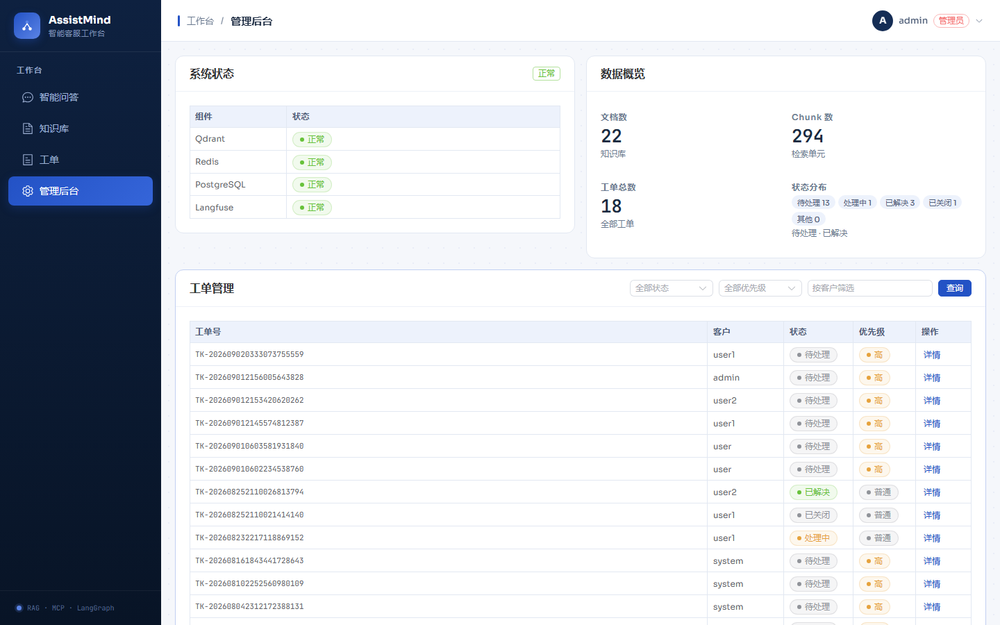
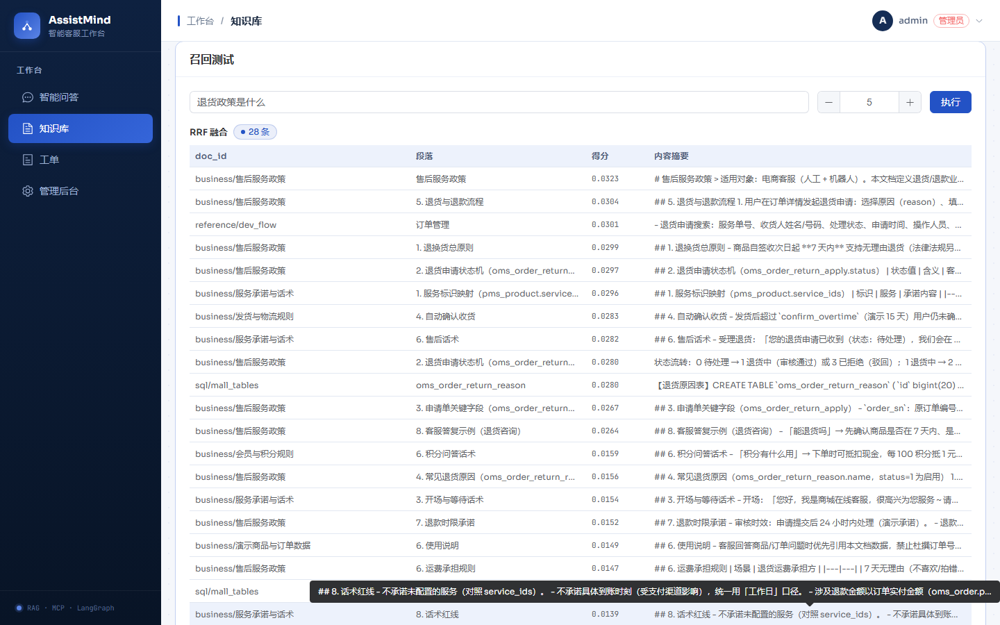

# AssistMind — E-commerce AI Customer Service

**English** · [简体中文](README.zh-CN.md)

**Repository**: [github.com/JDKmark/AssistMind](https://github.com/JDKmark/AssistMind)

> An e-commerce customer-service system built on RAG + Agent: **customer Q&A** (product enquiries, order lookup, logistics, after-sales requests) plus **human hand-off and ticket lifecycle**.
> Knowledge-base material is derived from the open-source [macrozheng/mall](https://github.com/macrozheng/mall) docs and table schema; business data is authored for this project (see [Credits](#credits)).
> Note: the UI and seeded demo data are in Chinese, matching the target scenario.

**Contents**: [Screenshots](#screenshots) · [Features](#features) · [Core scenarios](#core-scenarios) · [Quick start](#quick-start) · [Configuration](#configuration) · [Design notes](#design-notes) · [Tech stack](#tech-stack) · [Evaluation](#evaluation) · [Project layout](#project-layout) · [Credits](#credits) · [License](#license)



> Interactive version: [docs/assistmind-architecture.html](docs/assistmind-architecture.html) — zoomable, and every component links back to its source path.

## Screenshots

> Captured from a local demo instance (real pipeline: RAG retrieval and generation, Agent tool calls over MCP).

| | |
|---|---|
|  |  |
|  |  |
|  |  |
|  |  |

## Features

- **Hybrid retrieval**: Qdrant vector recall + BM25 keyword recall (jieba word-level tokenisation) run in parallel, fused with RRF (configurable weights), then reranked
- **Query rewriting**: Multi-Query on by default (3 variants recalled in parallel) + optional HyDE + passive rewrite when CRAG scores low
- **Structure-aware chunking**: Markdown headings, fenced code blocks kept intact, tables never split mid-row, `mall_tables.sql` chunked per `CREATE TABLE`
- **Agent tool calling**: ToolAgent (ReAct) calls tools over MCP to validate an order → file an after-sales request → create a ticket, streaming every step to the frontend as SSE events
- **MCP server + client**: FastMCP server (8 tools) and client; ToolAgent never calls local functions directly, so tools and agent stay decoupled
- **Three-tier intent routing**: rules → semantic → LLM, 4 intent classes (faq / task / chat / unclear), routes hot-reloaded from config
- **Fallback everywhere**: circuit breakers plus a full fallback matrix; BM25 is a first-class path (answers still work when Qdrant is down)
- **Async task queue (RQ)**: knowledge-base rebuild / bad-case export / evaluation runs are Redis jobs — the HTTP call returns a `job_id` immediately, a separate worker consumes it, failures retry, status is pollable
- **Voice**: ASR via the browser Web Speech API (on-device) + two-tier TTS (backend edge-tts cloud voices → browser `speechSynthesis` fallback)
- **Persona tones**: an external `personas.json` (professional / gentle / lively) hot-reloaded by mtime; tone is switched at the prompt layer, no fine-tuning required
- **Observability**: end-to-end Langfuse traces (single instrumentation point for LLM calls + per-conversation FAQ traces)
- **Evaluation**: 4 RAGAS metrics over a 50-item mall dataset (6 adversarial samples included)
- **Bad-case loop**: user feedback → conversation-level evidence chain in Langfuse → visual trace in the admin console → low-score samples reflowed into the evaluation set (see `docs/rag-iteration.md`)
- **CI/CD**: GitHub Actions (ruff + pytest + vitest) + husky pre-commit hooks

## Core scenarios

### E-commerce support: RAG Q&A + Agent tool calls

Two families of questions, routed automatically by intent:

| Scenario | Example question | Pipeline |
|---|---|---|
| Product / policy questions | "Who pays for shipping?" "Can coupons stack?" "What is the return policy?" | faq intent → RAG retrieval (vector + BM25 + RRF + rerank + CRAG) → grounded generation |
| Order / logistics lookup | "Look up my order" "Where is my parcel?" | task intent → ToolAgent → MCP `query_order` / `query_logistics` |
| After-sales request | "I want to return this" "I need after-sales service" | task intent → ToolAgent → `query_order` validates status → `apply_refund` creates the request → ticket created |
| Human hand-off / ticket | "Connect me to a human" "File a ticket" | task intent → ToolAgent → `transfer_human` / `create_ticket` |

The frontend renders the whole run as an SSE stream: intent badge → query-rewrite hint → tool-call steps (tool name + arguments + result) → cited sources → final answer.

### Example: the full call chain for "I want to return this"

A complete run:

> User types "I want to return this" →
> 1. **Intent routing**: matches the task intent via keywords + semantic samples, no LLM call needed;
> 2. **ToolAgent decides**: inside the ReAct loop it first retrieves after-sales policy knowledge following "Retrieval Before Agency" (confirming preconditions: order shipped/completed, 7-day no-reason return, etc.), then chooses an action;
> 3. **Validate order status**: calls `query_order("20260801001")`, gets "shipped" (eligible), and relays that faithfully instead of making it up;
> 4. **Create the after-sales request**: calls `apply_refund(order_sn, reason)`; the data source re-validates status and creates the record (`refund_id=AF{order_sn}`, idempotent on repeat);
> 5. **Create a ticket**: calls `create_ticket` when needed, and confirms the turnaround time with the user;
> 6. **Report the result**: structured output with the request id, current status (processing) and what happens next.

Every tool call is pushed to the frontend as `tool_call` / `tool_result` SSE events, so the user watches "checking order → filing after-sales request → ticket created" happen live.

> Note: order / logistics / after-sales data uses an in-memory mock by default (zero dependencies). Set `MALL_DATA_SOURCE=real` to persist in PostgreSQL (with cross-process idempotency for after-sales requests) — see [Configuration](#configuration).

## Quick start

### 1. Prerequisites

```powershell
# Clone the repo
git clone https://github.com/JDKmark/AssistMind.git
cd AssistMind

# Backend virtualenv
cd backend
python -m venv venv
venv\Scripts\activate
pip install -e ".[dev]"
cp .env.example .env
# Edit .env and set DEEPSEEK_API_KEY
```

> Optional: with uv installed, `uv sync --frozen --extra dev` installs the exact versions pinned in `backend/uv.lock`.

### 2. Start dependencies (docker-compose)

```powershell
docker-compose up -d
```

Core services (Langfuse's own redis/clickhouse/minio/worker sub-services omitted):

| Service | Container | Port | Purpose |
|---|---|---|---|
| qdrant | smart-cs-qdrant | 6333 / 6334 | Vector store |
| redis | smart-cs-redis | 6379 | Cache / semantic cache |
| postgres | smart-cs-postgres | 5432 | Metadata (users / tickets / feedback) |
| langfuse-db / langfuse | smart-cs-langfuse-* | 3001 | Observability platform (optional, on by default in dev) |

> The application layer — backend / frontend / **worker** — lives in `docker-compose.app.yml` (layered on top of the root `docker-compose.yml`; start everything with `start-demo.ps1` or `docker compose -f docker-compose.yml -f docker-compose.app.yml up -d`). **worker** consumes the RQ queue (knowledge-base rebuild etc.) — a rebuild stays `queued` until it runs, so start it separately in manual dev mode (next section).

### 3. Initialize the database and seed the knowledge base

```powershell
cd backend

# Create tables + seed users (admin/agent/user)
venv\Scripts\python.exe scripts/init_db.py

# Load e-commerce data into PostgreSQL (only needed when MALL_DATA_SOURCE=real; skip for the mock)
# Same source as the mock demo data (scripts/seed_mall_db.py imports from mock_source, idempotent)
venv\Scripts\python.exe scripts/seed_mall_db.py

# E-commerce knowledge base (knowledge/mall/: upstream docs + our own business rules, structure-aware chunking)
venv\Scripts\python.exe scripts/seed_mall_kb.py --reset

```

### 4. Start the dev servers

```powershell
# Backend (terminal 1)
cd backend
uvicorn app.main:app --reload --port 8002

# RQ worker (terminal 2, optional but recommended): consumes async jobs
# (knowledge-base rebuild / bad-case export / evaluation). Without it a rebuild
# stays queued and never runs.
venv\Scripts\python.exe scripts/run_worker.py

# Frontend (terminal 3)
cd frontend
npm install
npm run dev
```

### 5. Open

- Frontend: http://localhost:5173
- API docs: http://localhost:8002/docs
- Langfuse: http://localhost:3001
- Demo accounts: admin/admin123 (admin) · agent/agent123 (support agent) · user/user123 (customer)

### 6. One-command start and deployment

- **One command** (recommended): run `.\start-demo.ps1` from the repo root — it pre-checks the environment, waits for dependencies to become healthy, creates and seeds the database on first run (and skips seeding when the vector collection is already populated), then starts backend + RQ worker + frontend and prints a demo cheat-sheet. Use `start-dev.ps1` for dev mode.
- **Cloud deployment** (public access): see `deploy/README.md` — recommended setup (a 2C4G lightweight cloud host plus the full Docker Compose script `bash deploy/deploy.sh`) and a zero-cost option (run locally and expose it with `cloudflared tunnel`).

## Configuration

### Data source mode

`MALL_DATA_SOURCE` selects where e-commerce data comes from: `mock` (default — in-memory demo data, zero dependencies) / `real` (PostgreSQL; run init_db + seed_mall_db first) / `auto` (`SELECT 1` health probe decides; falls back to mock). In `real` mode, after-sales requests persist and are idempotent across processes (unique constraint on `order_sn`).

### MCP connection caveat

`MCP_SERVER_URL` **must end with a trailing slash** (default `http://localhost:8002/mcp/`) — FastAPI answers a mounted path without the slash with a 307 redirect, and the MCP client does not follow redirects, so the connection fails with `Unexpected content type`. `MCPClient` also appends the missing slash when constructed.

### Observability (optional)

Without Langfuse keys, instrumentation is disabled automatically and no functionality is affected.

## Design notes

### RAG pipeline

```
User question
  → Query rewriting (Multi-Query, 3 variants; HyDE optional)
  → Hybrid retrieval: Qdrant vectors (bge-base-zh-v1.5, 768-d) + BM25 (jieba word-level, first-class)
  → RRF fusion (Reciprocal Rank Fusion, vector/BM25 weights configurable, equal by default)
  → Reranking (bge-reranker-v2-m3)
  → CRAG relevance check (high → generate / low → re-retrieve / fallback)
  → Semantic cache (Redis version-key INCR invalidation O(1) + lazy cleanup, L2 similarity match)
  → Generation (DeepSeek primary / Ollama fallback)
```

- **Structure-aware chunking**: `chunk_text` recognises Markdown headings (→ `section_title`), keeps fenced code blocks intact (allowed to exceed the limit) and never splits tables; `mall_tables.sql` is chunked per `CREATE TABLE` (→ `table_comment`); provenance-only documents (SOURCES.md) are excluded from the index.
- **Intent routing first**: RAG only serves the faq intent; task goes to the Agent, so no retrieval is wasted.
- **RBAC**: Qdrant payloads are filtered by the `security_group` field — no separate permission table.

### Agent

- **ToolAgent**: a LangGraph StateGraph-driven ReAct loop (think → act → …) with a loop breaker (iteration cap), missing-argument clarification (`CLARIFY:` follow-up), **entity-based argument filling** (rule-based extraction of order numbers / product IDs auto-fills `query_order` and friends, reducing hallucination and follow-ups; entities are also recovered from conversation history), and MCP-unavailable fallback. Design principle: **Retrieval Before Agency** — the agent works on top of ranked retrieval results instead of replacing retrieval.

### MCP server + client

FastMCP (the official Python SDK) implements a **server** (AssistMind-MCP, 8 tools) and a **client**. ToolAgent never calls local tool functions directly — everything goes through the MCP client → server protocol, so tool implementations and the agent stay fully decoupled:

| Group | Tools |
|---|---|
| Knowledge retrieval (1) | `search_knowledge` |
| E-commerce operations (4) | `query_order` / `query_logistics` / `query_product` / `apply_refund` |
| Tickets (3) | `create_ticket` / `transfer_human` / `get_ticket_status` |

### Fallback matrix

Every external call has an explicit fallback path (aiobreaker circuit breaker + timeout + retry); nothing fails silently:

| Component failure | Fallback |
|---|---|
| LLM call fails | retry → switch to Ollama → approximate from cache → template answer |
| Qdrant fails | BM25-only recall (BM25 can never be disabled) |
| BM25 fails | vector-only recall |
| Both recall paths fail | "no relevant documents found" + suggest human hand-off |
| Reranker fails | skip reranking, use RRF order |
| Redis cache fails | skip the cache, query directly |
| PostgreSQL fails | ticket APIs return 503; chat is unaffected |
| edge-tts fails | backend returns 503 + warning; frontend falls back to browser `speechSynthesis` |

### Observability

- End-to-end Langfuse traces: **one instrumentation point for LLM calls** (everything goes through `llm_factory.call_llm`, one `llm.call` span per call); callers only own orchestration-level spans (e.g. `chat_faq`), so nothing is instrumented twice.
- **Conversation-level FAQ traces**: each FAQ answer opens a `chat_faq` root trace where `query → retrieved sources → answer` forms an attributable evidence chain; the `trace_id` is returned in the SSE `done` event and stored with the feedback row (the entry point for bad-case attribution).

### Frontend

Vue 3 + Element Plus + Pinia (plain JavaScript). SSE is parsed with native `fetch` (`POST /api/v1/chat/ask`; events: start / retrieving / rewriting / generating / delta / tool_call / tool_result / done / error — `delta` carries per-chunk text and drives the typewriter effect). The routing process is visualised (rewrite hints, tool-call steps, cited sources). Built-in **voice interaction** (microphone ASR + cloud TTS with two-tier fallback) and a **persona selector** (professional / gentle / lively, sent as `persona` in the SSE request body).

## Tech stack

| Layer | Technology |
|---|---|
| Backend | Python 3.11 + FastAPI + LangChain 0.3 + LangGraph 0.2 |
| Frontend | Vue 3 + Element Plus + Pinia |
| Vector store | Qdrant 1.12 |
| Cache | Redis 7 |
| Metadata DB | PostgreSQL 15 |
| LLM | DeepSeek API (primary) + Ollama (fallback) |
| Embedding / Reranker | BAAI/bge-base-zh-v1.5 (768-d) / BAAI/bge-reranker-v2-m3 |
| Async jobs | RQ (Redis queue, dedicated worker process) |
| Voice | Web Speech API (ASR) + edge-tts (cloud neural TTS, free, no key) |
| MCP | FastMCP (official Python SDK) |
| Observability | Langfuse |
| Evaluation | RAGAS |
| CI/CD | GitHub Actions + husky pre-commit (ruff + pytest + vitest) |

## Evaluation

| Area | Script / data | Details |
|---|---|---|
| RAG quality | `scripts/run_eval.py` + 4 RAGAS metrics (faithfulness / answer_relevancy / context_precision / context_recall) | **50-item mall dataset** (scored by DeepSeek): `eval_mall_qa.json` (6 adversarial samples, grouped separately). Measured on the 44 regular samples (see `backend/eval/reports/eval_mall_50_20261029.json`): faithfulness 0.999 / context_precision 0.894 / context_recall 0.909 / answer_relevancy 0.903 |
| Agent tool calling | Unit tests (`tests/unit/test_tool_agent.py` and friends): task intent triggers tools, Retrieval Before Agency, missing-argument clarification, MCP-unavailable fallback, loop breaker | Tool-call paths are covered by tests |
| Agent end-to-end success | `scripts/run_eval_agent.py --entity-fill both`: 11 multi-turn support tasks (order lookup / logistics / multi-turn logistics / product / return flow / rejected refund / order not found / service promise / refund timeline / human hand-off / ticket creation), in-process MCP + BM25 fallback, asserting the tool chain and answer per task | Last full run **9/9 (100%)**; the human hand-off and ticket-creation tasks were added later and need a re-run |
| Bad-case regression | `scripts/export_feedback_badcases.py` (feedback with score ≤ 2 → `app/data/eval_feedback.json`) + `scripts/run_eval.py app/data/eval_feedback.json` (no-ground-truth mode skips context_recall automatically) | Production complaints become adversarial regression samples; A/B diffing before/after a change catches regressions — see `docs/rag-iteration.md` |

Known limitation: `answer_relevancy` fluctuates because the reverse-generated question can drift from the original intent — that is inherent to the metric, so it is not used as a quality gate. Read faithfulness for factuality, context_precision / context_recall for retrieval quality.

Evaluation commands:

```powershell
cd backend

# RAGAS evaluation (defaults to eval_mall_qa.json; a custom dataset path also works)
venv\Scripts\python.exe scripts/run_eval.py

# Bad-case regression: reflow low-score feedback (score<=2) into the eval set, then run in no-ground-truth mode
venv\Scripts\python.exe scripts/export_feedback_badcases.py [--limit 50]
venv\Scripts\python.exe scripts/run_eval.py app/data/eval_feedback.json

```

Requirements: `DEEPSEEK_API_KEY` set in `.env`; Qdrant running and seeded (falls back to BM25-only when unavailable). The script uses distinct non-zero exit codes to distinguish failure causes (LLM unavailable / knowledge source unavailable / no valid scores).

## Project layout

```
AssistMind/
├── backend/
│   ├── app/
│   │   ├── api/            # FastAPI routes (chat/auth/knowledge/jobs/ticket/feedback/mall/admin/tts/health)
│   │   ├── agents/         # ToolAgent (LangGraph ReAct)
│   │   ├── core/
│   │   │   ├── rag/        # RAG engine (recall + RRF fusion + rerank + CRAG) + document parsers (pdf/docx ETL)
│   │   │   ├── router/     # Intent routing (rules → semantic → LLM, 4 intents)
│   │   │   ├── cache/      # L2 semantic cache (Redis version-key invalidation)
│   │   │   ├── dialog/     # Conversation context (trim / extract / format + slot state machine)
│   │   │   ├── infra/      # Qdrant/Redis/PostgreSQL/LLM/Langfuse/TTS/circuit breaker
│   │   │   ├── mcp/        # MCP server (8 tools) + client
│   │   │   ├── mall/       # E-commerce data source (facade + mock/real impls + entity extraction, fields anchored to mall.sql)
│   │   │   ├── tasks/      # RQ async jobs (rebuild_knowledge_base / export_badcases / run_evaluation)
│   │   │   └── security/   # JWT + RBAC
│   │   ├── models/         # SQLAlchemy models (user/ticket/feedback/mall tables)
│   │   ├── schemas/        # Pydantic models
│   │   └── data/           # intent_routes.json / personas.json / eval_mall_qa.json / eval_feedback.json
│   ├── scripts/            # init_db / seed_mall_db / seed_mall_kb / run_eval / run_worker / export_feedback_badcases / check_kb_quality
│   └── tests/              # unit + integration tests
├── frontend/
│   └── src/
│       ├── views/          # pages: Login / Chat / Knowledge / Tickets / Admin / Orders
│       ├── stores/         # Pinia (auth/chat/knowledge/ticket/persona)
│       ├── api/            # axios wrappers; chat/tts use native fetch (SSE stream / binary audio)
│       └── utils/          # speech.js (ASR + two-tier TTS playback)
├── knowledge/              # knowledge-base sources (mall/ upstream material + our own business rules)
├── docs/                   # project docs (architecture, iteration notes)
├── deploy/                 # cloud deployment script and notes
├── docker-compose.yml      # infrastructure (qdrant/redis/postgres/langfuse)
├── docker-compose.app.yml  # application layer (backend/frontend/worker overlay)
└── AGENTS.md               # AI coding rules
```

## Credits

- **[macrozheng/mall](https://github.com/macrozheng/mall)**: the e-commerce knowledge-base material (upstream README, deployment docs, config files and an excerpt of the `mall_tables.sql` schema under `knowledge/mall/`) is taken from that project — see `knowledge/mall/SOURCES.md` for the exact scope. The business-rule documents (`knowledge/mall/business/`) are authored for this project, with fields anchored to the official `mall.sql` schema.

## License

[MIT](LICENSE)
